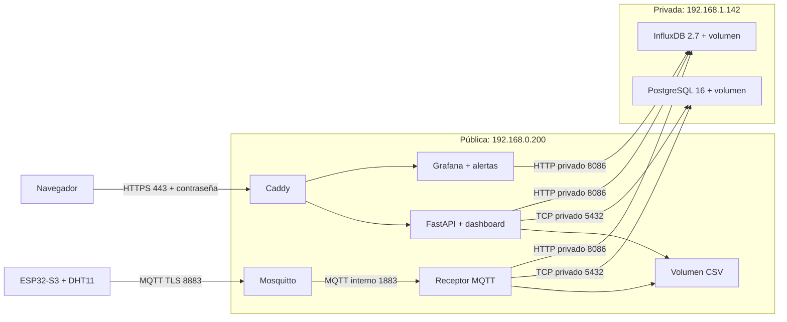

# Aplicación pública AWS con certificado para IP

Instalación para esta actividad: EC2 pública `3.231.16.96` (IP elástica), dirección privada `192.168.0.200`; PostgreSQL en la EC2 privada `192.168.1.142`. El 24 de octubre de 2026 se confirmó la aplicación remota, el acceso HTTPS, el certificado público, el temporizador de renovación y la captura física ESP32→MQTT TLS→PostgreSQL/CSV en AWS. Esta guía conserva los pasos para reproducir la instalación; las evidencias están en [validation.md](../../docs/validation.md).

**Actualización del 30 de octubre de 2026:** InfluxDB 2.7.12 en la privada y Grafana 13.2.5 por HTTPS quedaron desplegados y verificados con el sensor físico. Se comprobó el histórico, el disparo de falta de datos y su resolución. Discord es un canal adicional elegido, no un requisito acreditado de la consigna. La [bitácora](../../docs/bitacora-aws-actividad2.md) registra la ejecución, los recursos y los límites; el [guion de exposición](../../docs/guia-presentacion-actividad2.md) resume los resultados.

No se necesita comprar un dominio: [Let's Encrypt admite certificados para IP con Certbot 5.4 o superior](https://letsencrypt.org/2026/03/11/shorter-certs-certbot). Su vigencia es de seis días. Se usa Certbot 5.8, renovación mediante systemd y recarga de Caddy/Mosquitto. El ESP32 confía en las raíces ISRG; no hay que recompilarlo cada vez que se renueva el certificado del servidor.



## 1. Acceso de red

En los grupos de seguridad de AWS configurar:

| Instancia | TCP | Origen |
|---|---|---|
| Pública | 22 | IP pública del administrador /32 |
| Pública | 80 | 0.0.0.0/0, necesario para emitir y renovar por HTTP-01 |
| Pública | 443 | 0.0.0.0/0 para acceder al dashboard con contraseña |
| Pública | 8883 | IP de salida de la red del ESP32; para demostración con redes móviles cambiantes puede usarse 0.0.0.0/0, siempre con TLS, credenciales y ACL |
| Privada | 5432 | Grupo de seguridad de la pública o 192.168.0.200/32 |
| Privada | 8086 | Grupo de seguridad de la pública o 192.168.0.200/32 |
| Privada | 22 | Grupo de seguridad de la pública para el salto SSH |

La salida de la pública debe permitir PostgreSQL hacia `192.168.1.142:5432`, InfluxDB hacia `192.168.1.142:8086`, DNS y HTTPS para imágenes/ACME. No añadir reglas públicas para 1883, 8000, 5432 o 8086. Si UFW está habilitado, ajustar sus reglas manteniendo SSH; los puertos publicados por Docker también requieren el filtrado del grupo de seguridad. No desactivar el firewall.

## 2. Descargar y preparar en la EC2 pública

Ejecutar desde `ubuntu@ip-192-168-0-200`, no desde la máquina privada. Usar `exit` si todavía está dentro del salto SSH.

```bash
hostname
sudo apt-get update
sudo apt-get install -y git python3 openssl
git clone https://github.com/didcasva/Actividad_1_IoT_IA.git ~/Actividad_1_IoT_IA
cd ~/Actividad_1_IoT_IA
```

Si el repositorio ya existe, entrar en su carpeta y ejecutar `git pull --ff-only` en lugar de clonarlo. No copiar el `.env` de Windows. Preparar credenciales propias para AWS:

```bash
python3 scripts/setup_aws_app.py --sudo-docker --public-ip 3.231.16.96 --db-host 192.168.1.142 --device UM1
```

Cuando pregunte, introducir **MONITOR_PASSWORD** del `.env` de `~/rutasalud-db` en la máquina privada. No usar POSTGRES_PASSWORD, que pertenece al administrador, ni pegar claves en el chat. La entrada permanece oculta. El script conserva las credenciales si se repite con el mismo destino; genera la configuración de Mosquitto, el acceso al dashboard y un archivo de firmware separado. `.env`, `.secrets` y `.backups` están excluidos de Git y de las imágenes.

## 3. Obtener el certificado público

Verificar que el puerto 80 esté libre en la EC2 pública y permitido en AWS. El siguiente comando inicia un servidor temporal de validación HTTP y solicita un certificado real. Solo ejecutarlo aquí, con la IP elástica asignada a esta instancia:

```bash
python3 scripts/aws_certificate.py issue --sudo-docker
sudo python3 scripts/aws_certificate.py sync --no-reload
```

Opcionalmente añadir `--email tu-correo` a `issue`. Sin esa opción se registra la cuenta ACME sin correo. Si falla la validación, revisar IP elástica, grupo de seguridad, ruta al Internet Gateway y puerto 80 antes de reintentar. No sustituir el certificado por uno autofirmado ni desactivar su validación.

## 4. Iniciar aplicación, broker y receptor

Detener el servidor temporal para liberar el puerto 80. Los comandos usan un Compose diferente del laboratorio LAN; no arrancan otra base de datos:

```bash
sudo docker compose --env-file deploy/aws-app/.env -f deploy/aws-app/compose.yaml --profile bootstrap stop acme-web
sudo docker compose --env-file deploy/aws-app/.env -f deploy/aws-app/compose.yaml build api
sudo docker compose --env-file deploy/aws-app/.env -f deploy/aws-app/compose.yaml --profile app up -d --no-build --wait --wait-timeout 120
sudo docker compose --env-file deploy/aws-app/.env -f deploy/aws-app/compose.yaml exec -T api python scripts/register_device.py --code UM1 --sensor DHT11
sudo docker compose --env-file deploy/aws-app/.env -f deploy/aws-app/compose.yaml --profile app ps
```

Las migraciones se aplican a la base privada antes de iniciar la API y el receptor. `register_device.py` solo registra metadatos de la unidad; no inventa mediciones ni reemplaza dispositivos existentes. El dispositivo inicial de demostración `esp32-01` de la migración se conserva por compatibilidad; seleccionar UM1 para el equipo físico.

## 5. Activar y comprobar renovación

```bash
sudo python3 scripts/aws_certificate.py install-timer
sudo python3 scripts/aws_certificate.py dry-run
systemctl list-timers rutasalud-cert-renew.timer
```

El timer comprueba renovación dos veces al día y después del arranque. `dry-run` ensaya ACME en staging sin instalar ese certificado de pruebas. La renovación normal valida cadena, IP, vigencia y correspondencia de la clave; activa el par certificado/clave mediante un enlace atómico y fuerza la recarga de Caddy y SIGHUP de Mosquitto. Si la renovación falla, revisar y corregir antes de que caduque el certificado:

```bash
sudo journalctl -u rutasalud-cert-renew.service -n 60 --no-pager
```

El puerto 80 debe seguir accesible para las renovaciones. Fuera de la ruta ACME redirige a HTTPS.

## 6. Acceder al dashboard

Abrir [UM1 en AWS](https://3.231.16.96/?device_code=UM1). El navegador pedirá las credenciales generadas en `deploy/aws-app/.env`: `DASHBOARD_USERNAME` y `DASHBOARD_PASSWORD`. Consultarlas en la terminal propia con `nano deploy/aws-app/.env`, sin compartir capturas del archivo. El usuario predeterminado es `rutasalud`.

El dashboard y las consultas requieren contraseña. El POST de ingestión HTTPS utiliza `X-API-Key`; no utiliza la contraseña del navegador. Los servicios internos siguen comunicándose por la red Docker, y solo la API queda enlazada a `127.0.0.1:8000` para diagnóstico SSH. Sin sensor conectado es correcto que UM1 todavía no tenga lecturas o indique falta de recepción.

## 7. Cambiar el ESP32 a AWS

Una vez saludables los servicios, descargar desde la EC2 pública `.secrets/aws-firmware/mqtt.config.h` mediante SCP/SFTP a una carpeta privada del PC. Guardar una copia del `mqtt.config.h` LAN y reemplazarlo en `firmware/esp32_dht_monitor/`. Mantener `config.h` con el Wi-Fi real, `DEVICE_CODE="UM1"`, `DHT_PIN=4` y `DHT_TYPE=DHT11`.

La configuración generada incluye IP elástica, puerto 8883, credencial de UM1, `MQTT_TLS=1` y raíces CA. Compilar y cargar con la misma selección ESP32S3 Dev Module, flash 16 MB, PSRAM deshabilitada y USB CDC habilitado. El Wi-Fi debe tener salida a Internet y NTP para que el ESP32 valide la vigencia del certificado. Nunca usar `setInsecure()` ni copiar la clave privada del servidor al dispositivo.

Topics de UM1: publica `rutasalud/UM1/telemetria` y `rutasalud/UM1/estado`; recibe `rutasalud/UM1/ack`. El receptor confirma `stored` después de PostgreSQL y CSV, y entonces se retira la muestra de la cola persistente del ESP32.

Comprobar desde la EC2 pública:

```bash
sudo docker compose --env-file deploy/aws-app/.env -f deploy/aws-app/compose.yaml logs --tail 40 mqtt-worker broker
python3 scripts/verify_device.py --device UM1 --samples 3 --timeout 60
sudo docker compose --env-file deploy/aws-app/.env -f deploy/aws-app/compose.yaml exec -T api python scripts/verify_csv.py
```

`verify_device.py` consulta por defecto el puerto local 8000; no genera datos. En cada instalación comprobar nuevas mediciones y acuses del ESP32; la instalación descrita ya pasó esta comprobación. La cola anterior puede contener muestras pendientes de la LAN: conserva su identidad al reenviarlas; no se borra la NVS durante esta migración.

## 8. Conectar InfluxDB

Con InfluxDB iniciado y el token creado según [la guía de la EC2 privada](../aws-db/README.md#influxdb), actualizar el código y agregar la conexión. El token se pide sin mostrarlo:

```bash
git pull --ff-only
curl -s http://192.168.1.142:8086/health
python3 scripts/setup_influx.py --env-file deploy/aws-app/.env --url http://192.168.1.142:8086
sudo docker compose --env-file deploy/aws-app/.env -f deploy/aws-app/compose.yaml build api
sudo docker compose --env-file deploy/aws-app/.env -f deploy/aws-app/compose.yaml --profile app up -d --no-build --wait --wait-timeout 120
sudo docker compose --env-file deploy/aws-app/.env -f deploy/aws-app/compose.yaml exec -T api python scripts/reconcile_influx.py
sudo docker compose --env-file deploy/aws-app/.env -f deploy/aws-app/compose.yaml exec -T api python scripts/verify_influx.py
```

`reconcile_influx.py` carga en InfluxDB el histórico de PostgreSQL y se puede repetir sin duplicar puntos. `verify_influx.py` compara cada medición por unidad, tiempo y valores. Ejecutarlo con el sensor detenido o repetirlo si una fila nueva llegó entre las dos consultas. `/health` informa `influx: ok`, `error` o `disabled`, sin marcar la API como no saludable. No hay cambios en el ESP32.

## 9. Conectar Grafana y el canal de avisos

Con InfluxDB conectado, el token de lectura creado y el [webhook de Discord](../../docs/grafana.md#crear-el-webhook-de-discord) disponible. Comprobar antes la memoria con `free -h`, porque Grafana se suma a los servicios de esta EC2. El token y el webhook se piden sin mostrarlos:

El webhook corresponde al contacto que aprovisiona la plantilla actual. Para desplegar una variante sin Discord, ajustar el punto de contacto y la política de notificaciones. En la ejecución registrada ambas EC2 tenían alrededor de 1 GiB de RAM y se agregó swap de 1 GiB. La descarga de Grafana dejó la raíz original al 97 %; se amplió el EBS público a 15 GiB y la raíz a unos 14 GiB, con 7,1 GiB libres después de crecer. Ese estado es una medición del ensayo, no una garantía de capacidad para cargas mayores.

```bash
python3 scripts/setup_grafana.py --env-file deploy/aws-app/.env
sudo docker compose --env-file deploy/aws-app/.env -f deploy/aws-app/compose.yaml --profile app --profile grafana up -d --no-build --wait --wait-timeout 120
sudo docker compose --env-file deploy/aws-app/.env -f deploy/aws-app/compose.yaml --profile app restart caddy
```

Abrir `https://3.231.16.96/grafana/`, usuario `admin` y clave `GRAFANA_ADMIN_PASSWORD` de `deploy/aws-app/.env`. Grafana no abre puertos nuevos: Caddy lo publica por 443 y Grafana llega a InfluxDB por la VPC. Al actualizar servicios, incluir siempre `--profile grafana` para no dejarlo fuera. Reglas y prueba de alertas en [Grafana](../../docs/grafana.md).

## 10. Persistencia y arranque

Los volúmenes conservan CSV, sesiones MQTT y estado de Grafana; `.env`, `.secrets` y los archivos de aprovisionamiento permanecen en el disco del servidor. Los cinco servicios públicos permanentes tienen `restart: unless-stopped`. Docker y containerd quedaron confirmados como `enabled`; el temporizador del certificado como `enabled` y `active`.

La swap quedó registrada en `/etc/fstab`. La comprobación del reinicio completo de ambas EC2 todavía no tiene un resultado aportado; no se debe confundir configuración de inicio con una prueba de arranque ya ejecutada. Procedimiento y pendientes en la [bitácora](../../docs/bitacora-aws-actividad2.md#pendientes-y-prueba-de-reinicio-para-otra-sesión).

## Alcance y operación

Probado primero localmente en contenedores aislados: migraciones contra PostgreSQL externo, login HTTPS, API key, MQTT TLS con verificación CA/IP, ACK de guardado, idempotencia, CSV y recarga de certificados, con una CA exclusiva de pruebas. Después se verificó el despliegue real con certificado público y ESP32 físico en AWS. Los ensayos locales y remotos se distinguen en [validation.md](../../docs/validation.md).

El CSV y la cola MQTT usan volúmenes propios del proyecto `rutasalud-app`; PostgreSQL conserva su volumen en la otra EC2. No ejecutar `down -v` al actualizar. Mantener respaldos fuera de ambas instancias y ensayar restauración. El rol `monitor` no es superusuario y posee la base para las migraciones académicas; separar migrador y rol de ejecución es una mejora posterior. El enlace SQL entre EC2 usa la red privada y controles de acceso; este ejemplo no configura TLS para PostgreSQL.
