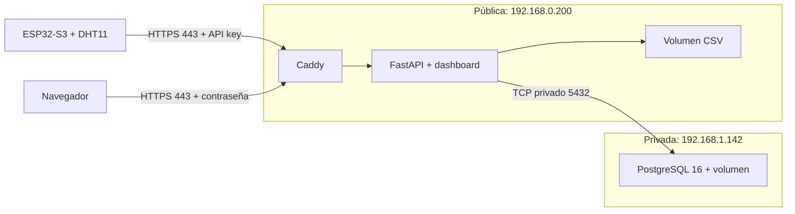

# Aplicación pública AWS con certificado para IP

Instalación para esta actividad: EC2 pública `3.231.16.96` (IP elástica), dirección privada `192.168.0.200`; PostgreSQL en la EC2 privada `192.168.1.142`. El 24 de octubre de 2026 se confirmó la aplicación remota, el acceso HTTPS, el certificado público, el temporizador de renovación y la captura física en AWS, entonces con MQTT TLS desde la rama `main`. Esta rama envía por HTTPS, pendiente de probar con el ESP32 físico. Esta guía conserva los pasos para reproducir la instalación; las evidencias están en [validation.md](../../docs/validation.md).

No se necesita comprar un dominio: [Let's Encrypt admite certificados para IP con Certbot 5.4 o superior](https://letsencrypt.org/2026/03/11/shorter-certs-certbot). Su vigencia es de seis días. Se usa Certbot 5.8, renovación mediante systemd y recarga de Caddy. El ESP32 confía en las raíces ISRG; no hay que recompilarlo cada vez que se renueva el certificado del servidor.



## 1. Acceso de red

En los grupos de seguridad de AWS configurar:

| Instancia | TCP | Origen |
|---|---|---|
| Pública | 22 | IP pública del administrador /32 |
| Pública | 80 | 0.0.0.0/0, necesario para emitir y renovar por HTTP-01 |
| Pública | 443 | 0.0.0.0/0 para acceder al dashboard con contraseña |
| Privada | 5432 | Grupo de seguridad de la pública o 192.168.0.200/32 |
| Privada | 22 | Grupo de seguridad de la pública para el salto SSH |

La salida de la pública debe permitir PostgreSQL hacia `192.168.1.142:5432`, DNS y HTTPS para imágenes/ACME. No añadir reglas públicas para 8000 o 5432. Si UFW está habilitado, ajustar sus reglas manteniendo SSH; los puertos publicados por Docker también requieren el filtrado del grupo de seguridad. No desactivar el firewall.

## 2. Descargar y preparar en la EC2 pública

Ejecutar desde `ubuntu@ip-192-168-0-200`, no desde la máquina privada. Usar `exit` si todavía está dentro del salto SSH.

```bash
hostname
sudo apt-get update
sudo apt-get install -y git python3 openssl
git clone https://github.com/didcasva/Actividad_1_IoT_IA.git ~/Actividad_1_IoT_IA
cd ~/Actividad_1_IoT_IA
```

Si el repositorio ya existe, entrar en su carpeta y ejecutar `git pull --ff-only` en lugar de clonarlo. No copiar el `.env` de Windows. Preparar credenciales propias para AWS:

```bash
python3 scripts/setup_aws_app.py --sudo-docker --public-ip 3.231.16.96 --db-host 192.168.1.142 --device UM1
```

Cuando pregunte, introducir **MONITOR_PASSWORD** del `.env` de `~/rutasalud-db` en la máquina privada. No usar POSTGRES_PASSWORD, que pertenece al administrador, ni pegar claves en el chat. La entrada permanece oculta. El script conserva las credenciales si se repite con el mismo destino; genera el acceso al dashboard y un archivo de firmware separado. `.env`, `.secrets` y `.backups` están excluidos de Git y de las imágenes.

## 3. Obtener el certificado público

Verificar que el puerto 80 esté libre en la EC2 pública y permitido en AWS. El siguiente comando inicia un servidor temporal de validación HTTP y solicita un certificado real. Solo ejecutarlo aquí, con la IP elástica asignada a esta instancia:

```bash
python3 scripts/aws_certificate.py issue --sudo-docker
sudo python3 scripts/aws_certificate.py sync --no-reload
```

Opcionalmente añadir `--email tu-correo` a `issue`. Sin esa opción se registra la cuenta ACME sin correo. Si falla la validación, revisar IP elástica, grupo de seguridad, ruta al Internet Gateway y puerto 80 antes de reintentar. No sustituir el certificado por uno autofirmado ni desactivar su validación.

## 4. Iniciar la aplicación

Detener el servidor temporal para liberar el puerto 80. Los comandos usan un Compose diferente del laboratorio LAN; no arrancan otra base de datos:

```bash
sudo docker compose --env-file deploy/aws-app/.env -f deploy/aws-app/compose.yaml --profile bootstrap stop acme-web
sudo docker compose --env-file deploy/aws-app/.env -f deploy/aws-app/compose.yaml build api
sudo docker compose --env-file deploy/aws-app/.env -f deploy/aws-app/compose.yaml --profile app up -d --no-build --wait --wait-timeout 120
sudo docker compose --env-file deploy/aws-app/.env -f deploy/aws-app/compose.yaml exec -T api python scripts/register_device.py --code UM1 --sensor DHT11
sudo docker compose --env-file deploy/aws-app/.env -f deploy/aws-app/compose.yaml --profile app ps
```

Las migraciones se aplican a la base privada antes de iniciar la API. `register_device.py` solo registra metadatos de la unidad; no inventa mediciones ni reemplaza dispositivos existentes. El dispositivo inicial de demostración `esp32-01` de la migración se conserva por compatibilidad; seleccionar UM1 para el equipo físico.

## 5. Activar y comprobar renovación

```bash
sudo python3 scripts/aws_certificate.py install-timer
sudo python3 scripts/aws_certificate.py dry-run
systemctl list-timers rutasalud-cert-renew.timer
```

El timer comprueba renovación dos veces al día y después del arranque. `dry-run` ensaya ACME en staging sin instalar ese certificado de pruebas. La renovación normal valida cadena, IP, vigencia y correspondencia de la clave; activa el par certificado/clave mediante un enlace atómico y fuerza la recarga de Caddy. Si la renovación falla, revisar y corregir antes de que caduque el certificado:

```bash
sudo journalctl -u rutasalud-cert-renew.service -n 60 --no-pager
```

El puerto 80 debe seguir accesible para las renovaciones. Fuera de la ruta ACME redirige a HTTPS.

## 6. Acceder al dashboard

Abrir [UM1 en AWS](https://3.231.16.96/?device_code=UM1). El navegador pedirá las credenciales generadas en `deploy/aws-app/.env`: `DASHBOARD_USERNAME` y `DASHBOARD_PASSWORD`. Consultarlas en la terminal propia con `nano deploy/aws-app/.env`, sin compartir capturas del archivo. El usuario predeterminado es `rutasalud`.

El dashboard y las consultas requieren contraseña. El POST de ingestión HTTPS utiliza `X-API-Key`; no utiliza la contraseña del navegador. Los servicios internos siguen comunicándose por la red Docker, y solo la API queda enlazada a `127.0.0.1:8000` para diagnóstico SSH. Sin sensor conectado es correcto que UM1 todavía no tenga lecturas o indique falta de recepción.

## 7. Cambiar el ESP32 a AWS

Una vez saludables los servicios, descargar desde la EC2 pública `.secrets/aws-firmware/http.config.h` mediante SCP/SFTP y copiarlo a `firmware/esp32_dht_monitor/`. Mantener `config.h` con el Wi-Fi real, `DEVICE_CODE="UM1"`, `DHT_PIN=4` y `DHT_TYPE=DHT11`. El archivo generado reemplaza `API_URL` y `API_KEY` por la URL HTTPS y la clave de AWS, e incluye las raíces CA.

Compilar y cargar con la misma selección ESP32S3 Dev Module, flash 16 MB, PSRAM deshabilitada y USB CDC habilitado. El Wi-Fi debe tener salida a Internet y NTP para que el ESP32 valide la vigencia del certificado. Nunca usar `setInsecure()` ni copiar la clave privada del servidor al dispositivo.

El ESP32 envía el JSON por POST con `X-API-Key`. Caddy lo reenvía a FastAPI sin pedir la contraseña del dashboard. La muestra se retira de la cola al recibir una respuesta 2xx, que FastAPI entrega después de guardar en PostgreSQL y CSV.

Si la EC2 ya tenía Mosquitto y el receptor de la rama `main`, actualizar con `sudo docker compose --env-file deploy/aws-app/.env -f deploy/aws-app/compose.yaml --profile app up -d --build --remove-orphans` y quitar la regla 8883 del grupo de seguridad.

Comprobar desde la EC2 pública:

```bash
sudo docker compose --env-file deploy/aws-app/.env -f deploy/aws-app/compose.yaml logs --tail 40 api caddy
python3 scripts/verify_device.py --device UM1 --samples 3 --timeout 60
sudo docker compose --env-file deploy/aws-app/.env -f deploy/aws-app/compose.yaml exec -T api python scripts/verify_csv.py
```

`verify_device.py` consulta por defecto el puerto local 8000; no genera datos. En cada instalación comprobar nuevas mediciones y respuestas `POST 200` en el monitor serie. La cola anterior puede contener muestras pendientes de la LAN: conserva su identidad al reenviarlas; no se borra la NVS durante esta migración.

## Alcance y operación

Probado primero localmente en contenedores aislados: migraciones contra PostgreSQL externo, login HTTPS, API key, idempotencia, CSV y recarga de certificados, con una CA exclusiva de pruebas. Los ensayos locales y remotos se distinguen en [validation.md](../../docs/validation.md).

El CSV usa un volumen propio del proyecto `rutasalud-app`; PostgreSQL conserva su volumen en la otra EC2. No ejecutar `down -v` al actualizar. Mantener respaldos fuera de ambas instancias y ensayar restauración. El rol `monitor` no es superusuario y posee la base para las migraciones académicas; separar migrador y rol de ejecución es una mejora posterior. El enlace SQL entre EC2 usa la red privada y controles de acceso; este ejemplo no configura TLS para PostgreSQL.
