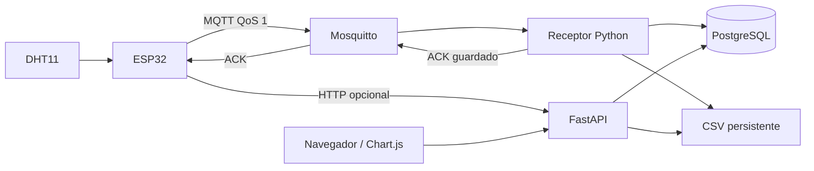

# Arquitectura

Caso de uso: observar temperatura y humedad del área de atención de unidades móviles de salud. Cada Device identifica una unidad y su sensor. No se capturan pacientes, historias clínicas ni geolocalización. Es un prototipo académico, sin certificación clínica.

Las rutas validan el contrato HTTP; los esquemas Pydantic validan los datos; ingestion aplica las reglas por sensor; el repositorio construye consultas SQLAlchemy. PostgreSQL confirma primero la transacción. Después se reconstruye el CSV bajo bloqueo interproceso y se reemplaza atómicamente dentro del mismo volumen. El índice único resuelve reintentos concurrentes.

El perfil Compose `mqtt` agrega Mosquitto y `mqtt-worker`. El receptor valida topic, `device_code` y JSON con el mismo esquema y llama al mismo servicio de ingestión. Solo publica el acuse `stored` después de SQL/CSV; el ESP32 mantiene la muestra en NVS hasta ese acuse. La presencia del archivo privado `mqtt.config.h` selecciona MQTT en el firmware; sin ese archivo se conserva HTTP. El dashboard usa HTTP en ambos casos. Ver [topics, permisos, reintentos y pruebas](mqtt.md).

No existe una transacción distribuida entre archivo y PostgreSQL: una interrupción puede dejar el CSV atrasado, pero la tarea de reconciliación al iniciar y cada 30 segundos lo recupera. Si falla el CSV durante ingestión, la API devuelve 503 aunque la fila ya esté confirmada: el firmware reintenta la misma identidad. GET /health verifica SQL y reconstrucción del archivo.

La reconstrucción completa prioriza simplicidad e integridad para una demostración de bajo volumen. Su costo crece con el histórico; para un uso prolongado debe evolucionar a una proyección incremental con outbox transaccional, sin modificar el contrato del dispositivo.

El ESP32 guarda hasta 60 muestras en NVS (10 minutos a 10 s). Con conectividad intermitente conserva muestras y reintenta con espera progresiva. Al llenarse rechaza muestras nuevas y lo informa por Serial. Es una cola limitada, no almacenamiento indefinido. Las escrituras frecuentes en flash requieren evaluar desgaste para una instalación real; usar SD o almacenamiento diseñado para registros continuos en producción.

Referencias: [orden de arranque en Compose](https://docs.docker.com/compose/how-tos/startup-order/), [Preferences ESP32](https://docs.espressif.com/projects/arduino-esp32/en/latest/api/preferences.html).
