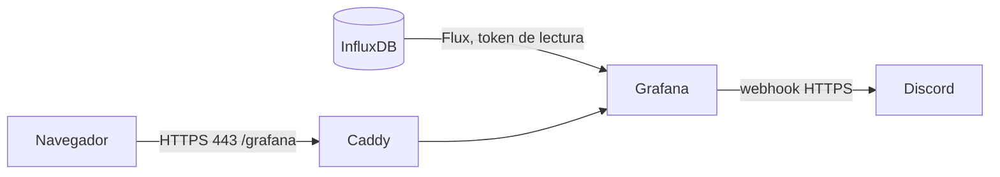

# Grafana: visualización y alertas

Grafana 13 lee el bucket `telemetria` de InfluxDB. La fuente de datos, el dashboard **Monitoreo ambiental**, las alertas y la notificación se aprovisionan desde `grafana/provisioning`, sin configuración manual.



## Alertas

| Regla | Dispara cuando | Espera |
| --- | --- | --- |
| Temperatura fuera de rango | Última lectura fuera de 15 a 30 °C | 1 minuto |
| Humedad fuera de rango | Última lectura fuera de 30 a 75 % | 1 minuto |
| Sin mediciones de UM1 | Ningún punto en los últimos 2 minutos | 1 minuto |

Los umbrales son de un prototipo académico, no criterios clínicos. Se cambian en `params` de `grafana/provisioning/alerting/rules.yaml`, y las líneas del dashboard en `rutasalud.json`. Las reglas se evalúan cada minuto. En la prueba de la Actividad 2, las de temperatura y humedad se dispararon en unos 95 segundos y la de falta de datos en unos 3 minutos y 40 segundos. La notificación avisa al dispararse, cada hora si continúa y al resolverse.

## Crear el webhook de Discord

En un servidor de Discord propio: **Ajustes del servidor → Integraciones → Webhooks → Nuevo webhook**, elegir el canal y copiar la URL. Esa URL permite publicar en el canal: tratarla como una clave, sin pegarla en el chat ni en Git.

## Uso local

Con InfluxDB ya configurado según [datos](database.md#influxdb):

```sh
python scripts/setup_grafana.py --local
docker compose --profile influx --profile mqtt --profile grafana up -d --build
```

Abrir `http://127.0.0.1:3000`, usuario `admin` y clave `GRAFANA_ADMIN_PASSWORD` del `.env`.

## Probar en la presentación

- **Humedad:** soplar sobre el DHT11 durante unos segundos, con el aire húmedo sube sobre 75 %. Debe mantenerse alta unos 2 minutos para que la regla complete su espera.
- **Sin mediciones:** desconectar el ESP32 unos 5 minutos. Al reconectarlo llega el mensaje de resolución.

Una lectura normal posterior resuelve la alerta y Discord recibe el aviso.

## Respaldo y límites

`grafana_data` guarda el estado de alertas y usuarios. El dashboard y las reglas se recuperan del repositorio. Los cambios hechos desde la interfaz sobre elementos aprovisionados no se conservan: editar los archivos. La regla de falta de datos se define solo para UM1; cada unidad nueva necesita su propia regla. Si Grafana inicia antes de que lleguen mediciones, esa regla se dispara y se resuelve al recibirlas.
