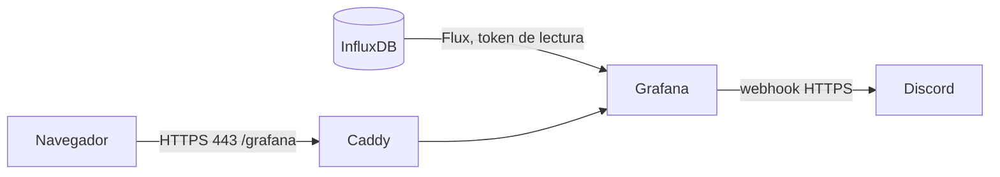

# Grafana: visualización y alertas

Grafana 13 lee el bucket `telemetria` de InfluxDB. La fuente de datos, el dashboard **Monitoreo ambiental**, las alertas y la notificación se aprovisionan desde `grafana/provisioning`, sin configuración manual.

**Estado en AWS al 30 de octubre de 2026:** Grafana 13.2.5 saludable y accesible en `https://3.231.16.96/grafana/`. Se confirmaron el dashboard, las tres reglas, el disparo por falta de mediciones y su resolución, con avisos reales en Discord. Ver [evidencias](validation.md#actividad-2-en-aws) y [operación](bitacora-aws-actividad2.md).

**Discord es un complemento opcional de la implementación**, no un requisito académico acreditado. Las alertas pueden evaluarse y visualizarse en Grafana sin ese canal. La configuración actual aprovisiona un contacto Discord y lo usa en la política de notificaciones; una instalación sin Discord requiere ajustar ese archivo y su política, en lugar de dejar una URL vacía. La consigna original de la actividad 2 no está en el repositorio.



## Alertas

| Regla | Dispara cuando | Espera |
| --- | --- | --- |
| Temperatura fuera de rango | Última lectura fuera de 15 a 30 °C | 1 minuto |
| Humedad fuera de rango | Última lectura fuera de 30 a 75 % | 1 minuto |
| Sin mediciones de UM1 | Ningún punto en los últimos 2 minutos | 1 minuto |

Los umbrales son de un prototipo académico, no criterios clínicos. Se cambian en `params` de `grafana/provisioning/alerting/rules.yaml`, y las líneas del dashboard en `rutasalud.json`. Las reglas se evalúan cada minuto. En el ensayo local con datos sintéticos, las de temperatura y humedad se dispararon en unos 95 segundos y la de falta de datos en unos 3 minutos y 40 segundos. Esas duraciones no se cronometraron en AWS. La notificación avisa al dispararse, cada hora si continúa y al resolverse.

## Crear el webhook de Discord

En un servidor de Discord propio: **Ajustes del servidor → Integraciones → Webhooks → Nuevo webhook**, elegir el canal y copiar la URL. Esa URL permite publicar en el canal: tratarla como una clave, sin pegarla en el chat ni en Git.

## Uso local

Con InfluxDB ya configurado según [datos](database.md#influxdb):

```sh
python scripts/setup_grafana.py --local
docker compose --profile influx --profile mqtt --profile grafana up -d --build
```

Abrir `http://127.0.0.1:3000`, usuario `admin` y clave `GRAFANA_ADMIN_PASSWORD` del `.env`.

## Probar en la presentación

- **Sin mediciones, verificado en AWS:** desconectar el ESP32 unos cinco minutos, observar `Firing`, reconectarlo y comprobar `Normal` después de nuevas lecturas y la siguiente evaluación. Si se usa Discord, comprobar también el aviso y `Resolved`.
- **Temperatura y humedad:** los disparos se verificaron con datos sintéticos en el entorno local aislado. La prueba física de esos dos umbrales en AWS queda pendiente; no insertar muestras simuladas en el histórico real de UM1 para demostrarlos.

Una lectura normal posterior resuelve la alerta y Discord recibe el aviso.

El [guion de presentación](guia-presentacion-actividad2.md) propone cómo mostrar la demostración y explicar los resultados sin confundir los ensayos locales con los remotos.

## Respaldo y límites

`grafana_data` guarda el estado de alertas y usuarios. El dashboard y las reglas se recuperan del repositorio. Los cambios hechos desde la interfaz sobre elementos aprovisionados no se conservan: editar los archivos. La regla de falta de datos se define solo para UM1; cada unidad nueva necesita su propia regla. Si Grafana inicia antes de que lleguen mediciones, esa regla se dispara y se resuelve al recibirlas.
