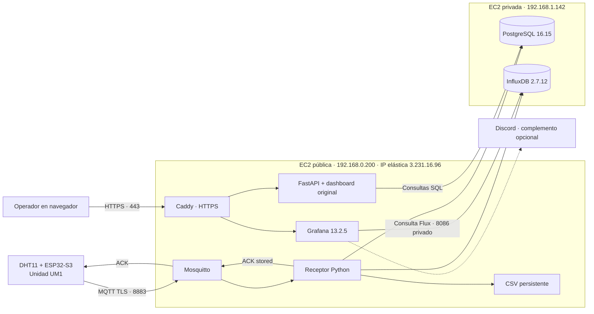
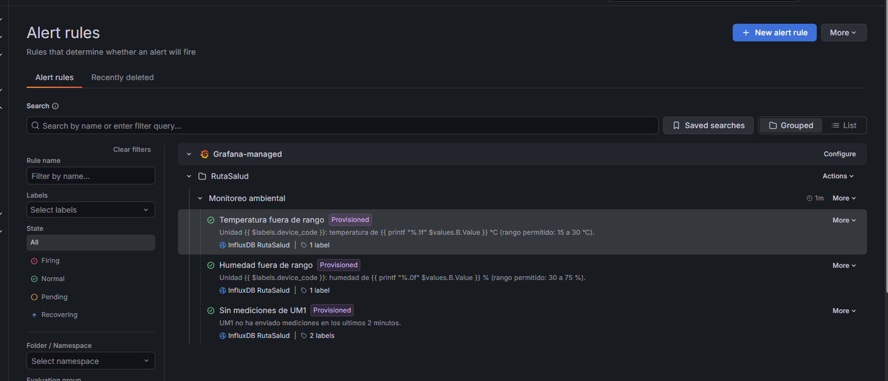

# Ruta Salud: guía para la presentación de la actividad 2

**Corte de la evidencia:** 30 de octubre de 2026, hora de Colombia (`America/Bogota`). Algunos registros del servidor llevan fecha 31 de octubre porque están en UTC.

## Arquitectura



PostgreSQL e InfluxDB reciben las conexiones por la red privada. La comunicación exterior del ESP32 utiliza TLS y la del navegador HTTPS. En esta instalación las conexiones internas a PostgreSQL y a InfluxDB no tienen TLS adicional.

## Guion de exposición de 8 a 10 minutos

### 1. Problemática y objetivo

Las mediciones ocasionales y los registros manuales dificultan reconstruir las condiciones ambientales de una jornada. El objetivo del prototipo es automatizar la captura, conservar el histórico por unidad y facilitar su consulta. Se mide el ambiente del punto donde se instala el sensor; no se capturan datos de pacientes ni temperatura corporal.

**Frase de apoyo:** “Buscamos que cada lectura tenga unidad, fecha y trazabilidad, y que una interrupción de recepción también sea visible”.

### 2. Hardware y datos transmitidos

La unidad física usa un ESP32-S3 y un sensor DHT11. El firmware toma una muestra cada diez segundos y construye un JSON con seis campos:

| Campo | Explicación para la exposición |
| --- | --- |
| `device_code` | Unidad que envía, por ejemplo `UM1`. |
| `temperature_c` | Temperatura ambiental en grados Celsius. |
| `humidity_percent` | Humedad relativa en porcentaje. |
| `boot_id` | Identificador del arranque del dispositivo. |
| `sequence_number` | Número de muestra dentro de ese arranque. |
| `measured_at` | Fecha de la medición en UTC, o `null` si aún no hay hora sincronizada. |

El servidor agrega `id`, `device_id` y `received_at`. Si falta la hora del sensor, asigna la recepción a `measured_at`; eso no reconstruye una hora histórica desconocida.

### 3. Cómo se envía la información

En el despliegue actual se utiliza **MQTT con TLS en el puerto 8883**. El topic de datos es `rutasalud/UM1/telemetria`.

La instrucción de publicación en el [firmware](../firmware/esp32_dht_monitor/esp32_dht_monitor.ino) es:

```cpp
const bool published = mqtt.publish(telemetryTopic, body, false, 1);
```

`body` contiene el JSON; `false` indica que la publicación no es retenida y `1` selecciona QoS 1. También existe `http.POST(body)` como alternativa de compilación. El dashboard utiliza consultas HTTP `GET` a la API.

El ESP32 conserva la muestra en NVS hasta recibir el ACK de la aplicación. En AWS, con InfluxDB habilitado, ese ACK se publica después de completar PostgreSQL, CSV e InfluxDB. El acuse del broker por sí solo no confirma esos tres destinos.

### 4. Por qué usamos PostgreSQL, CSV e InfluxDB

| Componente | Función |
| --- | --- |
| PostgreSQL | Fuente de verdad, inventario de dispositivos e histórico con restricciones de integridad. |
| CSV | Archivo físico recuperable y formato de exportación para consultar o analizar las mediciones. |
| InfluxDB | Proyección de series de tiempo que consulta Grafana. |

La identidad única `(device_id, boot_id, sequence_number)` evita insertar de nuevo una muestra reintentada. El CSV se reconstruye desde PostgreSQL y se reemplaza mediante un archivo temporal. InfluxDB puede recargarse desde el mismo histórico con `reconcile_influx.py`.

**Límite que se debe explicar:** las tres escrituras no forman una transacción distribuida. PostgreSQL confirma primero; un fallo posterior requiere reintento o reconciliación.

### 5. Qué aporta Grafana

Grafana consulta el bucket `telemetria`, de la organización `rutasalud`, usando un token de solo lectura. El dashboard **Monitoreo ambiental** muestra temperatura, humedad, sus gráficas y las alertas. Se publica por el mismo HTTPS de la aplicación en la ruta `/grafana/`.

Hay tres reglas aprovisionadas desde archivos del repositorio:

| Regla | Condición del prototipo |
| --- | --- |
| Temperatura fuera de rango | Última lectura menor que 15 °C o mayor que 30 °C. |
| Humedad fuera de rango | Última lectura menor que 30 % o mayor que 75 %. |
| Sin mediciones de UM1 | Ausencia de puntos de UM1 en la ventana de los últimos dos minutos. |

Las reglas tienen una espera de un minuto y evaluación cada minuto; el disparo no es instantáneo. Los umbrales son de demostración académica, no criterios clínicos ni límites regulatorios validados.

Discord se añadió como **canal opcional de notificación**. La evaluación y visualización de las alertas pertenecen a Grafana. No se presenta Discord como un requisito acreditado de la consigna.

### 6. Resultados

| Evidencia | Resultado confirmado |
| --- | --- |
| Primera carga del histórico en AWS | 2.951 mediciones coincidentes entre PostgreSQL, InfluxDB y CSV en ese corte. |
| Recepción después de encender el ESP32 | Tres muestras nuevas: IDs 3184, 3185 y 3186, con 27,6 °C y 68 % de humedad. |
| Comparación después de la recuperación | 3.186 mediciones coincidentes entre PostgreSQL e InfluxDB, sin puntos adicionales. |
| Grafana por HTTPS | Endpoint de salud con `database: ok` y versión 13.2.5. |
| Dashboard y reglas | Visualización de datos y tres reglas confirmadas por el usuario. |
| Desconexión del sensor | Alerta “Sin mediciones de UM1” en `Firing` y aviso real recibido en Discord. |
| Reconexión del sensor | Nuevas lecturas, retorno a `Normal`, mensaje `Resolved` y gráficas actualizadas confirmados por el usuario. |

Los conteos pertenecen a momentos distintos: el sistema siguió recibiendo muestras. La comparación final de 3.186 corresponde a SQL/InfluxDB; la evidencia CSV compartida corresponde al corte inicial de 2.951.

Captura aportada durante la verificación guiada: las tres reglas están aprovisionadas y muestran estado `Normal` en ese momento.



### 7. Cómo conservamos los datos y arrancan los servicios

Los datos se guardan en volúmenes de Docker y la configuración en archivos del disco EBS. Docker y containerd quedaron habilitados al inicio en ambas EC2. Los siete servicios permanentes tienen `restart: unless-stopped`; la swap de 1 GiB en cada servidor está registrada en `/etc/fstab`. El temporizador del certificado está habilitado y activo en la pública.

**Estado de la prueba:** se comprobó la configuración de arranque. No se recibió evidencia del reinicio completo de ambas EC2; esa comprobación queda pendiente. Persistencia en un volumen y respaldo fuera de la instancia son necesidades diferentes.

## Material de consulta

- [Bitácora técnica y operación de AWS](bitacora-aws-actividad2.md).
- [Registro cronológico de validación](validation.md#actividad-2-en-aws).
- [Datos del ESP32, métodos HTTP/MQTT y CSV](comunicacion-y-csv.md).
- [Problemática y modelo relacional](modelo-datos-y-problematica.md).
- [Grafana y configuración de alertas](grafana.md).
