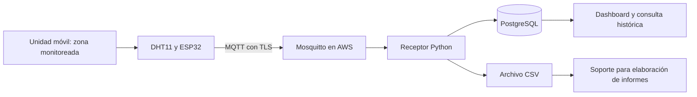
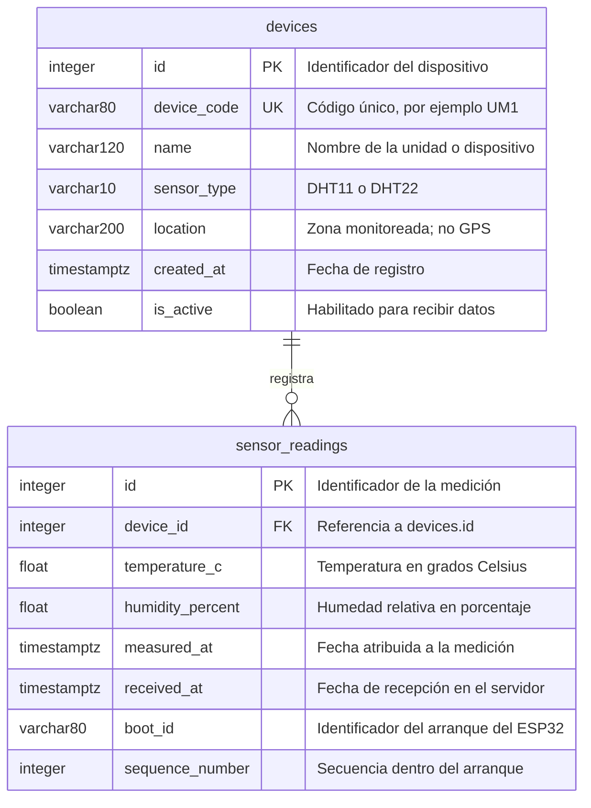

# Ruta Salud: problemática y modelo de datos

Documento de apoyo para la exposición académica. Esquema contrastado con los modelos y la migración inicial del proyecto el 30 de octubre de 2026. Describe PostgreSQL; InfluxDB y Grafana siguen pendientes para la Actividad 2.

## Problemática

Las unidades móviles de salud operan durante desplazamientos y jornadas de atención, con cambios de clima, ventilación, apertura de puertas y disponibilidad de energía y conectividad. Estas condiciones pueden modificar la temperatura y la humedad del área monitoreada. Cuando el seguimiento depende de anotaciones manuales o mediciones ocasionales, pueden quedar intervalos sin información, errores de transcripción y dificultades para reconstruir las condiciones de una jornada.

La falta de registros centralizados dificulta detectar desviaciones y preparar soportes verificables para los informes de calidad, las auditorías y los requerimientos sanitarios que correspondan a los servicios prestados. Cuando existen medicamentos o insumos con condiciones específicas de almacenamiento, la medición debe representar esa zona y contrastarse con los requisitos de los productos; una lectura en el área de atención no demuestra las condiciones de un refrigerador o de otro compartimiento.

## Objetivo

Automatizar la captura y conservación de temperatura y humedad por unidad móvil, para consultar el histórico por fechas y disponer de evidencia que apoye la gestión ambiental y la elaboración de informes.

La consulta histórica y la exportación CSV existen. La generación de informes aprobados, las alertas de umbral y el registro de acciones correctivas todavía no están implementados.

## Modelo relacional actual

**Relación:** un dispositivo puede tener cero o muchas mediciones. Cada medición pertenece a un solo dispositivo. `device_code` es único. En el prototipo, `UM1` identifica el dispositivo asignado a una unidad móvil; no existe una tabla independiente de vehículos, sedes o zonas.

**PK:** clave primaria. **FK:** clave foránea. **UK:** valor único.

### Tabla `devices`: inventario del punto de medición

| Campo | Tipo | Función |
| --- | --- | --- |
| `id` | INTEGER, PK | Identificador interno. |
| `device_code` | VARCHAR(80), UNIQUE | Código enviado por el ESP32 y usado en MQTT. |
| `name` | VARCHAR(120) | Nombre descriptivo de la unidad o dispositivo. |
| `sensor_type` | VARCHAR(10) | Tipo de sensor: DHT11 o DHT22. |
| `location` | VARCHAR(200) | Descripción de la ubicación del sensor. |
| `created_at` | TIMESTAMPTZ | Fecha de creación del registro. |
| `is_active` | BOOLEAN | Permite aceptar o rechazar nuevas mediciones del dispositivo. |

### Tabla `sensor_readings`: histórico ambiental

| Campo | Tipo | Función |
| --- | --- | --- |
| `id` | INTEGER, PK | Identificador interno de la muestra. |
| `device_id` | INTEGER, FK | Vincula la muestra con su dispositivo. |
| `temperature_c` | FLOAT | Valor de temperatura en °C. |
| `humidity_percent` | FLOAT | Valor de humedad relativa en %. |
| `measured_at` | TIMESTAMPTZ | Instante de medición si el ESP32 tiene hora sincronizada. |
| `received_at` | TIMESTAMPTZ | Instante en que el servidor recibió la muestra. |
| `boot_id` | VARCHAR(80) | Permite distinguir los reinicios del dispositivo. |
| `sequence_number` | INTEGER | Distingue las muestras de un mismo arranque. |

Todos los campos son obligatorios en las tablas. El contrato de entrada admite `measured_at = null`: en ese caso, el servicio lo sustituye por la hora de recepción. Ese valor no permite reconstruir la hora original de una muestra almacenada sin reloj. La base actual no conserva un indicador explícito de esa sustitución.

### Integridad y trazabilidad existentes

- La clave foránea evita mediciones sin dispositivo registrado.
- La combinación única `(device_id, boot_id, sequence_number)` evita insertar dos veces una misma muestra cuando MQTT reintenta su entrega.
- Un índice por `(device_id, measured_at)` facilita las consultas de una unidad por tiempo.
- PostgreSQL verifica humedad entre 0 y 100 %, temperatura entre -40 y 80 °C y secuencia no negativa. El servicio restringe adicionalmente las lecturas DHT11 a 0-50 °C. Son validaciones de datos y sensor, **no umbrales sanitarios**.
- Las fechas se manejan con zona horaria; para presentar un informe debe indicarse la zona utilizada.
- El receptor confirma el guardado al ESP32 después de persistir PostgreSQL y completar CSV. El archivo conserva las mediciones, pero no es por sí mismo un informe firmado ni inalterable.

## Cómo los registros apoyarían un informe

Propuesta de contenido; no representa un formato oficial definido ni una funcionalidad completa existente.

| Contenido | Situación actual |
| --- | --- |
| Código de unidad y zona monitoreada | Disponible en `devices`. |
| Periodo y zona horaria del informe | Hay filtros por fechas; falta un informe formal con esos metadatos. |
| Temperatura y humedad por instante | Disponibles en `sensor_readings`. |
| Tabla de mediciones exportable | Exportación CSV disponible. |
| Mínimos, máximos y promedios del periodo | Calculables a partir de las lecturas; pendiente incorporarlos al informe. |
| Umbrales aplicables y su fundamento | Pendiente definirlos por zona, uso y requisitos de los productos. |
| Desviaciones, duración y acciones tomadas | Pendientes reglas, tratamiento de intervalos sin datos y bitácora de gestión. |
| Periodos sin recepción y cobertura de datos | Hay aviso de recepción atrasada; falta consolidar los vacíos en el informe. |
| Identificación y calibración del sensor | Solo consta el tipo; faltan serie, verificaciones y soportes de calibración. |
| Elaboración, revisión y aprobación | Pendientes responsables, versión del informe y trazabilidad de aprobación. |

Los huecos de conectividad deben aparecer como falta de información, no como evidencia de condiciones normales. La cola del ESP32 es limitada a 60 muestras; cuando se llena, descarta nuevas lecturas. Un laboratorio AWS apagado durante varias horas puede producir vacíos que no se recuperan por completo.

## Relación con los requisitos sanitarios en Colombia

Como referencia para sustentar el caso de uso, el numeral 7 del estándar 11.1.4 de la Resolución 3100 de 2019 aborda las condiciones de almacenamiento de medicamentos e insumos: cuando aplica, exige instrumentos de temperatura y humedad, así como evidencia de registro, control y gestión conforme a las condiciones del fabricante. Ver [texto en el normograma de Supersalud](https://normograma.supersalud.gov.co/compilacion/docs/resolucion_minsaludps_3100_2019.htm).

La Resolución 1403 de 2007 incluye condiciones ambientales y registros para el almacenamiento de medicamentos dentro de su ámbito de aplicación. Ver [texto en el normograma del Invima](https://normograma.invima.gov.co/compilacion/docs/resolucion_minproteccion_1403_2007.htm).

El proyecto aporta un prototipo de captura y evidencia ambiental. Su uso en informes regulatorios requiere concretar, con el responsable de calidad de la institución, el servicio y zona cubiertos, requisitos aplicables, instrumentos adecuados y su calibración, continuidad del registro, gestión de desviaciones y revisión de los informes. El prototipo con DHT11 no constituye por sí solo una certificación de cumplimiento ni una validación de cadena de frío.

## Texto breve para la presentación

> Ruta Salud aborda la dificultad de mantener registros continuos y consultables de temperatura y humedad en unidades móviles de salud. Mediante un ESP32 y un sensor ambiental, transmite las mediciones por MQTT a AWS y las conserva en una base de datos y en CSV. Esto permite consultar el histórico por unidad y periodo, y prepara una base de evidencia para informes de seguimiento y auditoría. La evolución del proyecto incorpora alertas, gestión de desviaciones y validación de los instrumentos para apoyar los procesos de calidad de la institución.

## Fuentes técnicas del esquema

- `backend/app/models/entities.py`
- `backend/alembic/versions/001_initial.py`
- `backend/app/services/ingestion.py`
- `backend/app/schemas/readings.py`
- `docs/database.md`
