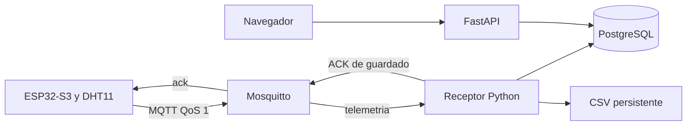

# MQTT local: ESP32, Mosquitto y confirmación de guardado

El perfil `mqtt` de Docker Compose agrega un broker Mosquitto y un receptor Python. Se conservan la API HTTP, el dashboard y los volúmenes PostgreSQL/CSV existentes. El esquema de mediciones no cambia.



## Topics y permisos

| Topic | Publica | Recibe | Retained |
| --- | --- | --- | --- |
| `rutasalud/UM1/telemetria` | ESP32 UM1 | Receptor | No |
| `rutasalud/UM1/ack` | Receptor | ESP32 UM1 | No |
| `rutasalud/UM1/estado` | ESP32 / última voluntad del broker | Diagnóstico autorizado, si se configura | Sí |

El receptor se suscribe a `rutasalud/+/telemetria`. `device-UM1` solo publica telemetría/estado de UM1 y lee su ACK. `rutasalud-worker` lee telemetría y publica ACK; no publica telemetría. Las conexiones anónimas están deshabilitadas. El topic debe coincidir con `device_code` del JSON. Los nombres distinguen mayúsculas. El dashboard sigue consultando FastAPI cada cinco segundos.

El generador inicial configura una unidad por instalación y rechaza sustituir otra silenciosamente. Para agregar unidades se necesitan usuarios, ACL y registros `devices` adicionales. El topic de estado conserva `online` y una última voluntad `offline`; todavía no se muestra en el dashboard, cuyo indicador usa la fecha de recepción de mediciones.

## 1. Preparar el servidor

Con Docker operativo, desde la raíz del proyecto, crear `.env` si aún no existe. En Windows:

```powershell
python scripts/setup_env.py
python scripts/setup_mqtt.py --host IP_LAN_DEL_SERVIDOR --device UM1
docker compose --profile mqtt up -d --build
docker compose --profile mqtt ps -a
```

En Ubuntu, usando Docker con sudo:

```bash
python3 scripts/setup_env.py
python3 scripts/setup_mqtt.py --sudo-docker --host IP_LAN_DEL_SERVIDOR --device UM1
sudo docker compose --profile mqtt up -d --build
sudo docker compose --profile mqtt ps -a
```

El script `setup_env.py` conserva un `.env` existente. `IP_LAN_DEL_SERVIDOR` es la IP de Windows o de Ubuntu donde corre el broker, sin esquema ni puerto. No usar `localhost` desde el ESP32. En VirtualBox usar [red puente](ubuntu-virtualbox.md). `--sudo-docker` eleva solo la llamada a Docker para generar hashes; los archivos privados permanecen bajo el usuario normal de Ubuntu.

`setup_mqtt.py` conserva las claves HTTP/BD y las credenciales MQTT que ya existan. Genera:

- `.secrets/mosquitto/passwords`: hashes mediante `mosquitto_passwd`; claves nunca como argumentos del proceso.
- `.secrets/mosquitto/acl`: permisos de receptor/dispositivo.
- `firmware/esp32_dht_monitor/mqtt.config.h`: host, puerto y credenciales del dispositivo.

Estos archivos están excluidos de Git. `.secrets` también se excluye de las imágenes. El puerto publicado se toma de `MQTT_PORT` en `.env`, 1883 por defecto. La conexión interna receptor/broker siempre usa `broker:1883`. El script no imprime contraseñas ni acepta los marcadores de `.env.example` como claves reales.

Estado esperado: `api`, `db`, `broker` y `mqtt-worker` saludables; `migrate` termina con código 0. PostgreSQL no publica su puerto al host. Persistencia en `taller1_postgres_data`, `taller1_csv_data` y `taller1_mqtt_data`. Para detener todos los servicios: `docker compose --profile mqtt stop`. No usar `down -v`.

Registrar UM1 si la base es nueva (en Ubuntu anteponer `sudo`):

```sh
docker compose exec db psql -U monitor -d monitor -c "INSERT INTO devices (device_code,name,sensor_type,location,created_at,is_active) VALUES ('UM1','Unidad movil de salud UM1','DHT11','Area de atencion',CURRENT_TIMESTAMP,true) ON CONFLICT (device_code) DO NOTHING;"
```

## 2. Preparar y cargar el ESP32

1. Mantener el archivo privado `config.h` con SSID/clave Wi-Fi, `DEVICE_CODE "UM1"`, DHT11 y GPIO4. En una instalación nueva, crearlo desde `config.example.h`.
2. En Arduino IDE instalar **ArduinoJson 7** y **MQTT by Joel Gaehwiler (256dpi, versión probada 2.5.3)**. Seleccionar la ESP32-S3 y las opciones que ya funcionaban.
3. Colocar el `mqtt.config.h` generado por el servidor junto al sketch del PC que programa la placa. Si el servidor es Ubuntu, transferir ese archivo privado mediante SSH/SCP. Comprobar su host y que `DEVICE_CODE` coincida con la unidad de sus permisos.
4. Compilar y cargar el firmware. La estructura de la cola NVS sigue en versión 1 y no se borra al cambiar de transporte.
5. Monitor serie a 115200: transporte MQTT, conexión/suscripción, publicación aceptada por broker y después **guardado confirmado en PostgreSQL/CSV**.

La presencia de `mqtt.config.h` activa MQTT. Retirarlo y recompilar activa HTTP. No se envía simultáneamente por ambos transportes. No cambia el cableado ni hace falta USB conectado a Ubuntu.

Transferencia desde Ubuntu al PC, en PowerShell desde la raíz del proyecto:

```powershell
$usuarioUbuntu = Read-Host "Usuario de Ubuntu"
$ipUbuntu = Read-Host "IP de Ubuntu"
scp "${usuarioUbuntu}@${ipUbuntu}:~/Actividad_1_IoT_IA/firmware/esp32_dht_monitor/mqtt.config.h" .\firmware\esp32_dht_monitor\mqtt.config.h
```

No cambiar `DEVICE_CODE` con muestras pendientes: el código no forma parte de cada muestra guardada en NVS y podrían reasignarse. Un ACK antiguo se ignora si no coincide con la cabeza actual de la cola.

## 3. Durabilidad y reintentos

Cada mensaje conserva `boot_id` y `sequence_number`. El ESP32 publica con QoS 1, sin retained, mantiene hasta 60 muestras en NVS y reintenta con espera progresiva. Solo retira la cabeza al recibir `status=stored` con la misma unidad, boot_id y secuencia. El PUBACK del broker por sí solo no elimina la muestra.

El ACK de aplicación se emite después de confirmar PostgreSQL y completar el CSV. Si falla el CSV después del commit SQL, el reintento repara el archivo sin duplicar la fila. Si se pierde un ACK, el ESP32 republica y recibe el mismo ID.

El receptor usa sesión persistente MQTT 3.1.1, suscripción QoS 1 y confirmación de transporte manual. Ante errores transitorios de almacenamiento termina sin confirmar el mensaje; Docker reinicia el proceso y el broker puede redeliverarlo. Los mensajes permanentemente inválidos se registran y descartan sin confirmar guardado al dispositivo. Una muestra/configuración inválida puede detener la cabeza de la cola hasta corregirla, igual que los 4xx del transporte HTTP.

Mosquitto conserva sesión y mensajes pendientes en `mqtt_data`. Son colas limitadas: 60 muestras en ESP32 y 1000 mensajes en la configuración del broker. QoS 1 admite duplicados; la unicidad SQL impide guardarlos varias veces. No se promete almacenamiento indefinido ni supervivencia a la pérdida de todos los discos.

Referencias: [biblioteca MQTT Arduino](https://github.com/256dpi/arduino-mqtt), [confirmación manual Paho](https://eclipse.dev/paho/files/paho.mqtt.python/html/client.html), [Mosquitto](https://mosquitto.org/).

## 4. Verificar mediciones físicas

Abrir `http://IP_LAN_DEL_SERVIDOR:8000/?device_code=UM1`. Con el ESP32 encendido:

```sh
python scripts/verify_device.py --device UM1 --samples 3 --timeout 45
docker compose exec api python scripts/verify_csv.py
docker compose logs --tail=40 mqtt-worker
```

En Ubuntu usar `python3` y `sudo docker`. `verify_device.py` solo consulta la API: no demuestra por sí mismo el protocolo de origen. Correlacionar nuevas IDs/secuencias con los logs del receptor y los acuses serie para demostrar MQTT. Detener simuladores y esperar el vaciado de muestras antiguas para comparar una lectura actual. La API HTTP sigue disponible para compatibilidad.

## 5. Pruebas sintéticas aisladas

**No ejecutar `verify_mqtt.py --allow-test-data` sobre el histórico físico.** Genera mensajes de prueba. Crear otro proyecto Compose con volúmenes y puertos separados. PowerShell:

```powershell
$env:API_PORT='18000'
$env:MQTT_PORT='18884'
docker compose -p taller1-mqtt-test --profile mqtt up -d --build
docker compose -p taller1-mqtt-test exec db psql -U monitor -d monitor -c "INSERT INTO devices (device_code,name,sensor_type,location,created_at,is_active) VALUES ('UM1','SIMULACION MQTT UM1','DHT11','Laboratorio aislado',CURRENT_TIMESTAMP,true) ON CONFLICT (device_code) DO NOTHING;"
docker compose -p taller1-mqtt-test run --rm --no-deps mqtt-worker python scripts/verify_mqtt.py --allow-test-data
Remove-Item Env:API_PORT
Remove-Item Env:MQTT_PORT
```

En Ubuntu iniciar con `sudo env API_PORT=18000 MQTT_PORT=18884 docker compose -p taller1-mqtt-test --profile mqtt up -d --build`. Los comandos posteriores `exec` y `run --no-deps` no recrean los puertos; anteponer `sudo` a Docker.

Se verifican ACK de guardado, mismo ID al repetir, una fila SQL/CSV, ACL de publicación, rechazo de ACK falsificado y conexiones anónimas/con contraseña incorrecta, además de JSON/identidad inválidos. Este ensayo no cuenta como captura física. Detener el entorno separado sin borrar volúmenes: `docker compose -p taller1-mqtt-test --profile mqtt stop`.

El 24 de octubre también se cargó el firmware en el ESP32-S3 físico y se verificaron muestras reales por MQTT y recuperación tras detener temporalmente el broker. Los resultados y límites están en [validación](validation.md).

## Alcance antes de AWS

El perfil actual publica MQTT sin TLS para una LAN de laboratorio controlada. No desplegarlo directamente a Internet. Faltan listener TLS/certificados, validación CA del ESP32 (`MQTT_TLS=1` y `MQTT_CA_CERT`), HTTPS y autenticación del dashboard, y PostgreSQL en la subred privada requerida. El firmware incluye la ruta TLS con verificación CA; su configuración y ensayo de nube siguen pendientes. Ver [plan AWS](cloud-migration.md).
